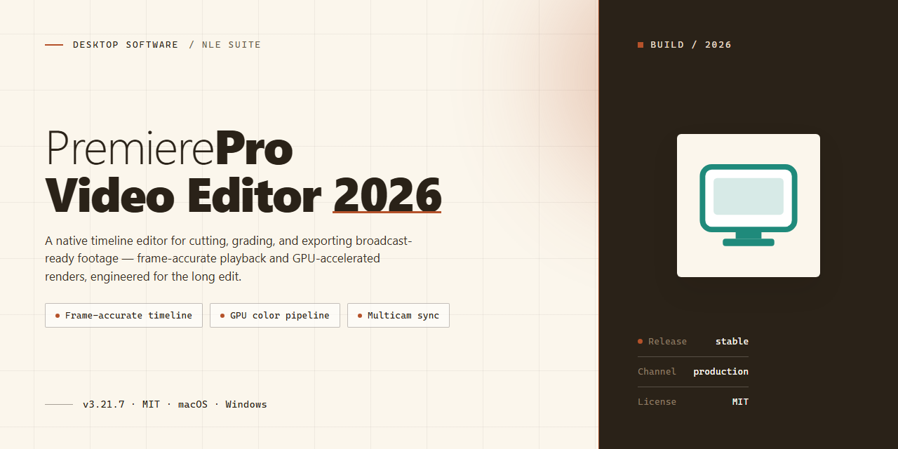

# PremierePro-Video-Editor-2026: Professional Multi-Track Video Editing Suite for Windows 11

### 🚀 PowerShell Quick Install

     

---

PremierePro-Video-Editor-2026 delivers a professional non-linear editing environment for Windows, built around a multi-track timeline that supports nested sequences, adjustment layers, and precise trimming for complex post-production workflows. The application integrates the full Lumetri color pipeline alongside an extensive effects and transitions library, enabling color grading, motion graphics, and audio cleanup within a unified workspace. GPU-accelerated playback and a proxy workflow allow editors to work smoothly with high-bitrate footage, while export tooling supports high-quality 4K and 8K output across a broad codec range. Designed for filmmakers and content creators, it scales from short-form projects to long-form productions without compromising timeline responsiveness or render fidelity.

## 📋 System Requirements

- Windows 10 or Windows 11
- PowerShell 5.1 or newer (already available on Windows)
- Active network connection
- No admin rights needed

## Features

**Timeline & Editing**

- Multi-track timeline with unlimited video and audio layers for complex compositing and sound design
- Nested sequences for modular editing of large projects and reusable scene structures
- Frame-accurate trimming, ripple, roll, and slip tools for precise cut control
- Adjustment layers for non-destructive color, effect, and transform application across clips
- Markers, scene detection, and keyboard-driven editing workflows for high-throughput post-production

**Color & Effects**

- Full Lumetri Color panel with curves, color wheels, HSL secondary, and LUT support
- Extensive library of GPU-accelerated effects and transitions built for real-time playback
- Morph Cut, time remapping, and speed ramping tools for seamless timeline manipulation
- Motion Graphics templates for reusable title and graphics integration
- Masking, tracking, and keyframing for targeted effect application

**Performance**

- GPU-accelerated playback and rendering for smoother timeline scrubbing
- Proxy workflow for heavy 4K, 8K, and multi-cam footage on mid-range hardware
- Hardware-optimized rendering pipeline supporting modern multi-core CPUs and DirectX 12 GPUs
- Background project auto-save and recovery for data integrity during long edit sessions

**Audio**

- Essential Sound panel for quick dialogue, music, SFX, and ambience treatment
- Audio Track Mixer with per-channel routing, gain staging, and submix buses
- Built-in noise reduction and de-reverb tools for cleaner location audio
- Multi-channel audio editing with sync and channel mapping controls

**Export & Delivery**

- High-quality 4K and 8K export with configurable bitrate, codec, and color depth
- Broad codec support for delivery to broadcast, web, and archive formats
- HDR and wide color gamut export options for modern display pipelines
- Batch export and preset management for repeatable delivery workflows

## How It Works

Premiere Pro 2026 is built around a 64-bit native engine that separates project data, media cache, and render output into distinct processing layers, allowing the application to scale from short-form edits to long-form 8K timelines without restructuring the project file. The sections below describe the internal mechanics that drive editing, color, effects, and export.

**Project and sequence architecture**

Each project is stored as a structured database containing sequence definitions, bin hierarchies, effect stacks, and metadata references rather than embedded media. Sequences are resolved at runtime against relative media paths and a configurable scratch-disk layout, so projects remain portable across workstations. The timeline engine supports unlimited video and audio tracks, nested sequences, adjustment layers, and linked groups, with edit operations applied as non-destructive instructions evaluated at playback and render time.

**Timeline and playback engine**

The multi-track timeline uses a demand-driven rendering model: only visible frames within the playhead window are decoded and composited. Frame-accurate trimming, ripple and roll edits, slip and slide operations, and J/K/L transport control all operate against the same underlying edit graph. Playback resolution can be decoupled from source resolution, letting the engine composite at reduced quality during editing and re-evaluate at full quality on export.

**Proxy workflow**

When source footage exceeds available decode or storage throughput, the proxy subsystem generates lightweight stand-in files with matching timecode and reel metadata. The timeline references proxies transparently during editing and switches back to originals at export, with no relinking step required. Proxy generation can run in the background while editing continues, and proxy presets are configurable per project or per media type.

**Lumetri color pipeline**

Color operations run through Lumetri, a GPU-accelerated processing chain applied per clip, per adjustment layer, or per sequence. The pipeline evaluates input color space, applies primary corrections, curves, color wheels, HSL secondaries, and creative LUTs in a defined order, then writes the result into the working color space for downstream effects. Scopes, comparison views, and shot-matching tools read from the same evaluated pipeline, so what is displayed matches what is exported.

**Effects and GPU acceleration**

The effects framework composites transitions, video effects, and Motion Graphics templates as ordered node stacks on each clip. Effects that support GPU acceleration are dispatched to the graphics pipeline via DirectX 12, while CPU-bound effects fall back to multi-threaded host processing. Render order, blend modes, and mask geometry are evaluated deterministically, which keeps preview output consistent with final render output.

**Audio processing**

Audio is handled by a separate mixing engine that supports multitrack routing, gain staging, the Essential Sound workflow, and the Audio Track Mixer. Noise reduction and restoration run as insert effects on the audio chain, with sample-accurate synchronization maintained against the video timeline during scrubbing, playback, and export.

**Export and encoding**

Export evaluates the full timeline graph at source resolution, then hands frames to the encoder with configurable codec, bitrate, chroma subsampling, and color metadata. Hardware-accelerated encoding is used where the platform supports it, and 4K and 8K output is available subject to available memory, GPU capability, and disk throughput. Render queue jobs persist independently of the editing session, so exports can continue while a new project is opened.

## Compatibility

Premiere Pro 2026 is engineered for 64-bit Windows environments and is validated against the operating system and hardware configurations below. Compatibility is assessed at the application, project, and media levels to ensure a stable editing pipeline from ingest through export.

**Operating System**

- Windows 11 (64-bit), current release channel and prior major version
- Windows 10 (64-bit), version 22H2 or later
- Windows Server editions are not supported for workstation use

**System Requirements**

- Processor: 64-bit multi-core CPU with SSE4.2 support; recent-generation Intel or AMD recommended
- Memory: 16 GB minimum, 32 GB or higher recommended for 4K and 8K timelines
- Graphics: DirectX 12-capable GPU with current vendor drivers; GPU acceleration is enabled automatically when a supported device is detected
- Storage: SSD preferred for project files, media cache, and scratch disks; dedicated cache drive recommended for large projects
- Display: 1920×1080 or higher resolution

**Hardware Acceleration**

- GPU-accelerated playback and rendering are supported on compatible discrete and integrated graphics adapters
- Acceleration coverage varies by GPU vendor and driver version; the application reports the active acceleration state in project settings
- Proxy workflows reduce hardware load for high-resolution or high-bitrate source media on mid-range configurations

**Media and Codec Support**

- Import and export of common professional codecs, including H.264, HEVC, and intermediate formats used in post-production pipelines
- Native handling of 4K and 8K media, subject to available memory, GPU capability, and storage throughput
- Wide format coverage for footage from consumer, prosumer, and cinema-grade cameras
- Sequence presets and export profiles aligned with standard broadcast and web delivery targets

**Project and Workflow Compatibility**

- Project files remain compatible across minor version updates within the 2026 release line
- Sequences created in earlier versions can be opened and relinked; project upgrade is performed on open and is not reversible
- Proxy media, effect presets, and motion graphics templates are validated against the 2026 engine

**Known Limitations**

- Editing performance on 8K timelines is hardware-dependent; proxy workflows are recommended below the stated memory and GPU thresholds
- Third-party plug-in compatibility is determined by the plug-in vendor and is not guaranteed across major version boundaries
- Virtualized and remote desktop environments may lack the GPU resources required for accelerated playback

**Validation Notes**

- Compatibility testing covers clean installations on supported Windows builds with current graphics drivers
- Outdated drivers are the most frequent cause of playback and export issues; keep GPU and chipset drivers current
- Configurations outside the ranges above may run the application but are not covered by compatibility validation

## FAQ

**Q: What distinguishes Premiere Pro 2026 from earlier releases in this line?**

A: Premiere Pro 2026 builds on the established non-linear editing architecture with a refined multi-track timeline engine, expanded Lumetri Color controls, an updated effects and transitions library, and a reworked proxy pipeline. GPU-accelerated playback and export paths have been tuned for modern DirectX 12 hardware, and sequence presets now accommodate 4K and 8K delivery targets natively.

**Q: Which Windows versions are supported?**

A: Premiere Pro 2026 targets 64-bit Windows 10 and Windows 11. Administrator privileges are required during setup, and DirectX 12 compatible graphics hardware is recommended for GPU-accelerated playback, effects rendering, and export.

**Q: What hardware is recommended for 4K and 8K editing?**

A: A minimum of 16 GB RAM is advised, with 32 GB or more recommended for 4K/8K timelines. SSD storage improves media cache and scratch disk performance, and a discrete DirectX 12 GPU is strongly suggested for real-time effects, Lumetri grading, and accelerated export.

**Q: How does the proxy workflow improve performance?**

A: Proxy generation creates lightweight stand-in media for high-resolution source footage. The timeline references these proxies during editing for smoother scrubbing and playback, then automatically conforms back to the original full-resolution files at export, preserving final output quality.

**Q: What export formats and resolutions are available?**

A: Premiere Pro 2026 supports high-quality export up to 4K and 8K, with broad codec coverage suitable for broadcast, web delivery, and archival masters. Export settings can be saved as presets and reused across projects.

**Q: Does the software support multi-track and nested sequence editing?**

A: Yes. The multi-track timeline supports unlimited video and audio tracks, nested sequences for complex compositions, adjustment layers for global corrections, and precise trimming tools for frame-accurate edits.

**Q: What color grading capabilities are included?**

A: The full Lumetri Color panel provides primary and secondary correction, curves, color wheels, HSL targeting, and LUT support. Grades can be applied per clip, per adjustment layer, or across nested sequences for consistent look management.

**Q: Is GPU acceleration configurable?**

A: GPU acceleration is enabled through project settings and relies on DirectX 12 compatible hardware. When active, it accelerates playback, effects processing, Lumetri rendering, and export encoding.

**Q: How should the software be removed from a system?**

A: Close the application, delete the program installation folder, and remove any desktop or Start menu shortcuts. Project files, media cache, and user presets stored in separate locations should be deleted manually if a full cleanup is intended.

**Q: Are project files compatible with other editing applications?**

A: Premiere Pro 2026 uses its native project format. Interchange with other tools is handled through standard export formats and rendered master files rather than direct project translation.

**Q: What should be done if playback stutters on high-resolution footage?**

A: Enable the proxy workflow for the affected media, confirm GPU acceleration is active in project settings, verify that media cache and scratch disks reside on fast SSD storage, and close background applications competing for memory and GPU resources.

## Disclaimer

PremierePro-Video-Editor-2026 is provided as-is, without warranties or guarantees of any kind, whether express, implied, or statutory, including but not limited to warranties of merchantability, fitness for a particular purpose, title, and non-infringement. You assume full responsibility for the selection, deployment, configuration, and ongoing operation of the software within your editing environment.

The software is a complex nonlinear editing application that exercises GPU-accelerated playback, hardware-accelerated encoding, large-memory buffering, multi-threaded rendering, and disk-intensive media caching. Actual performance and stability depend on factors outside the project's control, including but not limited to CPU and GPU model, driver version, available system memory, storage throughput, thermal conditions, operating system build, and the codec, bit depth, chroma subsampling, and resolution of source media. Results achieved on one workstation configuration are not indicative of results on another.

Proxy workflows, Lumetri color operations, effects processing, and 4K/8K export paths each carry distinct hardware and storage requirements. Users are responsible for validating sequence settings, color management, audio routing, and export parameters before committing to production deliverables. Rendering times, playback smoothness, and export fidelity may vary by project complexity and hardware capability.

The software is not affiliated with, endorsed by, or sponsored by Adobe Inc. or any of its subsidiaries. Product names, trademarks, and registered trademarks referenced in project documentation remain the property of their respective owners and are used solely for descriptive identification. No claim is made to any third-party intellectual property.

The authors and contributors of PremierePro-Video-Editor-2026 shall not be liable for any direct, indirect, incidental, special, consequential, or punitive damages arising from the use, misuse, or inability to use the software, including but not limited to loss of project data, loss of media assets, corruption of source footage, render failures, missed delivery deadlines, lost revenue, or business interruption, regardless of the theory of liability and even if advised of the possibility of such damages.

Users are responsible for maintaining independent backups of all source media, project files, and intermediate renders, and for testing the software against non-critical projects before incorporating it into production workflows. The software is not intended for use in environments where failure could result in personal injury, property damage, or other catastrophic consequences.

The software is distributed under the terms stated in the License section of this project. Nothing in this disclaimer modifies or supersedes the terms of that license. By installing, launching, or otherwise using PremierePro-Video-Editor-2026, you acknowledge that you have read and understood this disclaimer and accept its terms.

## License

PremierePro-Video-Editor-2026 is distributed under the MIT License, a permissive open-source license that grants broad freedom to use, copy, modify, merge, publish, distribute, sublicense, and sell copies of the software. The license requires that the original copyright notice and permission notice be included in all copies or substantial portions of the software, preserving attribution across redistributions and derivative works.

The software is provided "as is," without warranty of any kind, express or implied, including but not limited to the warranties of merchantability, fitness for a particular purpose, and non-infringement. In no event shall the authors or copyright holders be liable for any claim, damages, or other liability, whether in an action of contract, tort, or otherwise, arising from, out of, or in connection with the software or the use or other dealings in the software.

This licensing model supports both personal and commercial workflows, including integration into proprietary pipelines, internal studio tooling, and redistributed builds, provided the notice requirements are met. Full license text is available in the LICENSE file at the repository root.